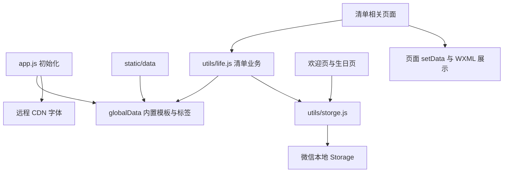

<!-- project-overview:generated:start -->
# A Life 项目概述

## 项目基本信息

| 项目 | 当前仓库可确认的信息 | 依据 |
| --- | --- | --- |
| 名称 | A Life；目录名称为 a-life | `app.json`、`pages/my/my.wxml` |
| 项目形态 | 原生微信小程序，单应用仓库；未发现独立后端或其他子应用 | `project.config.json` 的 `compileType: miniprogram`、`app.js` 的 `App()`、`pages/` 的 `Page()` |
| 用途 | 浏览人生清单模板、记录完成状态、创建个人清单并填写完成感想 | `pages/about/about.wxml`、`pages/lifeDetail/`、`pages/addList/`、`pages/itemDetail/` |
| 目标用户 | 希望记录生活体验、规划个人目标的用户；更具体的人群定位未确认 | `pages/about/about.wxml`、`pages/my/my.wxml` |
| 版本线索 | 页面显示 A Life 1.0；更新日志最后一条为 1.0.1（2025 年 2 月）；当前发布版本未确认 | `pages/my/my.wxml`、`static/data/logData.js` |
| 审查范围 | Git 根目录 `E:\Code\a-life` 下的应用配置、10 个页面、工具函数、静态数据及工程配置 | `app.json`、`pages/`、`utils/`、`static/data/`、`project.config.json` |
| 生成日期 | 2026-09-30（Asia/Shanghai） | 本次审查日期 |

本次为静态审查，未安装依赖，未运行应用、测试、构建或部署。跳过 Git 内部数据及生成产物；未读取本地密钥文件和 `project.private.config.json` 内容。审查开始时已存在 `pages/birthday/birthday.wxml` 的未提交修改，本概述基于当前工作区；该修改未被本次审查更改。

## 项目用途与功能清单

以下“有实现”表示页面和逻辑中找到对应证据，运行效果均未验证。

| 功能 | 可见入口与实现线索 | 确认程度与依据 |
| --- | --- | --- |
| 首次进入引导 | 欢迎页读取 `LIFE_INIT`，点击进入后保存标记并切换首页 | 有实现：`pages/index/index.js`、`pages/index/index.wxml` |
| 模板浏览 | 清单列表展示标题、说明和前 20 项预览；内置旅行、美食、影视、书籍、生活等模板 | 有实现：`pages/list/list.js`、`pages/list/list.wxml`、`static/data/list.js` |
| 分类与搜索 | 全部、热门、最新、定制和主题标签；根据标题搜索 | 有实现；组合筛选存在下文所述问题：`pages/list/list.js` 的 `updateLifeList()`、`static/data/tag.js` |
| 我的清单 | 首页合并已有本地存档的内置清单与非草稿自定义清单，显示完成进度 | 有实现：`pages/home/home.js`、`pages/home/home.wxml` |
| 完成标记与重置 | 点击清单项切换完成状态；更多操作可移除该清单的完成存档 | 有实现：`pages/lifeDetail/lifeDetail.js`、`utils/life.js` |
| 完成感想 | 长按已完成的项进入详情，填写并保存描述；详情页还提供取消勾选入口 | 有实现；再次勾选的持久化逻辑缺失：`pages/itemDetail/itemDetail.js`、`pages/itemDetail/itemDetail.wxml` |
| 自定义清单 | 输入标题、描述和清单项，支持增删改项；从列表或详情进入编辑、删除 | 有实现；编辑保存存在确定的变量使用问题：`pages/addList/addList.js`、`pages/list/list.js`、`utils/life.js` |
| 草稿 | 数据含 `isDraft`；列表显示草稿标签，首页排除草稿 | 部分实现；新建页面的草稿按钮受 `editDetail.isDraft` 限制，入口需确认：`pages/addList/addList.wxml`、`pages/home/home.js` |
| 生日与时间统计 | 保存生日，展示已过去的秒数、天数、夏天与夏季奥运次数 | 有实现；统计算法与定时器处理存在下文所述限制：`pages/birthday/`、`utils/util.js` |
| 清空数据 | 关于页提供确认弹窗，删除键名包含 `LIFE_LIST` 的本地记录 | 有实现；不会删除 `birthday`、`LIFE_INIT`，与“本地全部数据”提示范围不一致：`pages/my/my.js`、`utils/life.js` |
| 分享与客服 | 原生分享按钮、客服按钮、复制作者联系方式 | 找到入口；客服平台配置与分享实际效果未确认：`pages/my/my.wxml`、`pages/my/my.js`、`app.js` |
| 关于与更新日志 | 静态说明页面，以及从本地数据加载的版本日志 | 有实现：`pages/about/`、`pages/log/`、`static/data/logData.js` |

`static/data/list.js` 中共有 28 个未注释的模板 ID 定义，另有一个被注释的模板。模板内容随代码打包，未发现在线更新模板的请求逻辑；模板标题中的数量、排名和数据时效未逐项核验。

## 技术路径

| 层次 | 技术或工具 | 用途与现状 | 依据 |
| --- | --- | --- | --- |
| 语言与运行时 | JavaScript、微信小程序运行环境 | 使用 ES Modules、async/await、`App()`、`Page()` 和 `wx` API；未发现 TypeScript 配置 | `app.js`、`pages/`、`utils/`、`project.config.json` |
| 界面框架 | 原生 WXML / WXSS；配置 glass-easel | WXML 模板、事件绑定和 WXSS 样式；组件框架值已配置，实际兼容性未验证 | `app.json` 的 `componentFramework`、`pages/*/*.wxml`、`pages/*/*.wxss` |
| 组件库 | 微信原生组件 | 使用 `view`、`scroll-view`、`input`、`textarea`、`picker`、`button` 等；页面 `usingComponents` 均为空，未发现第三方组件库 | `pages/*/*.json`、`pages/*/*.wxml` |
| 路由 | 小程序页面注册与原生导航 | `app.json` 注册 10 页和 3 个 Tab；使用 `wx.navigateTo`、`wx.switchTab`、`wx.navigateBack` | `app.json`、`pages/` |
| 状态管理 | `App.globalData`、页面 `data` / `setData` | 全局提供内置模板、标签与联系配置，页面管理展示和输入状态 | `app.js`、`pages/home/home.js`、`pages/addList/addList.js` |
| 数据存储 | 微信本地 Storage | 同步 API 封装为 async 函数，清单以 JSON 字符串存储；未发现数据库或云同步代码 | `utils/storge.js`、`utils/life.js`、`pages/birthday/birthday.js` |
| 网络与外部资源 | `wx.loadFontFace`、远程 CDN 字体 | 应用启动时加载漫画字体；未发现业务 `wx.request` 或云调用 | `app.js`、`app.wxss` |
| 样式与资源 | WXSS、CSS 变量、Flex、rpx、PNG | 全局主题变量与公共样式，页面专属样式、本地图标 | `app.wxss`、`pages/*/*.wxss`、`static/images/` |
| 编译配置 | 微信开发者工具项目配置 | ES6、PostCSS、增强编译和压缩已配置；基础库为 `trial`，未固定数字版本 | `project.config.json` |
| 认证与后端 | 未能从当前仓库确认 | `wx.login` 仅存在于注释中；未发现服务端、认证流程或数据库配置 | `app.js`、当前仓库文件结构 |
| 代码规范 | ESLint 配置 | 声明 ES2018、模块语法及微信全局对象；`rules` 为空，推荐规则被注释，版本与执行方式未确认 | `.eslintrc.js` |
| 测试 | minitest 配置线索 | `testRoot` 指向 `minitest/`，仅发现 `treeData: []` 配置，未发现测试用例或测试脚本 | `project.config.json`、`minitest/test.config.json` |
| 辅助脚本 | Node.js 内置 `fs` | 根目录脚本读取文本并输出 JSON；与小程序页面无已确认调用关系，所需输入文件未发现 | `index.js` |

仓库未发现 `package.json` 或依赖锁文件，因此无法整理 npm 依赖范围、锁定版本、Node.js 版本要求和包管理器要求。`glass-easel`、ESLint 等配置值不能替代安装版本或运行验证。

## 架构概览



调用依据：`app.js`、`pages/home/home.js`、`pages/list/list.js`、`pages/lifeDetail/lifeDetail.js`、`pages/addList/addList.js`、`utils/life.js`、`utils/storge.js`。页面通过 `getAllLifeList()` 合并内置模板与自定义清单，再叠加各清单的完成存档；进度在页面或工具函数中计算。

| 本地键 | 内容 | 依据 |
| --- | --- | --- |
| `LIFE_INIT` | 是否完成首次进入引导 | `pages/index/index.js` |
| `LIFE_LIST_<id>` | `{ selectedItems: [{ name, description? }] }` 的 JSON 字符串 | `utils/life.js`、`pages/itemDetail/itemDetail.js` |
| `LIFE_LIST_CUSTOM` | 自定义清单数组，包含标题、描述、项列表、标签及草稿状态 | `utils/life.js`、`pages/addList/addList.js` |
| `birthday` | 日期文本和时间戳的 JSON 字符串 | `pages/birthday/birthday.js` |

未发现用户账号关联、数据导出、跨设备同步或服务端备份实现。关于页也明确说明数据在本地且更换设备可能丢失；本地缓存本身不能证明数据安全或可恢复。依据：`pages/about/about.wxml`、`utils/storge.js`。

## 目录结构

```text
a-life/
├─ app.js / app.json / app.wxss  应用初始化、页面注册与全局样式
├─ pages/
│  ├─ index/                   欢迎与首次进入
│  ├─ home/                    我的清单与完成进度
│  ├─ list/                    模板浏览、搜索与分类
│  ├─ lifeDetail/              清单项完成操作与清单管理
│  ├─ itemDetail/              完成感想
│  ├─ addList/                 自定义清单新增与编辑
│  ├─ birthday/                生日与时间统计
│  └─ my/、about/、log/         关于、联系入口与更新日志
├─ utils/                      清单、存储、提示与统计工具
├─ static/data/                内置模板、标签与更新日志
├─ static/images/              页面图标
├─ minitest/                   空测试树配置
├─ style/                      本次未发现目录内文件
├─ index.js                    独立文本处理脚本
├─ .eslintrc.js                 ESLint 配置
└─ project.config.json         小程序编译、打包与测试目录配置
```

目录职责依据上述目录中的源文件；`project.private.config.json` 存在，但本次未读取其内容。

## 开发与运行方式

仓库未发现 README、依赖清单、安装说明或 package scripts，无法从现有资料确认安装、启动、构建、测试、检查和部署的命令，因此不提供推测的 npm/pnpm 命令。

| 操作 | 仓库中的线索 | 本次状态 |
| --- | --- | --- |
| 打开与编译 | 根据 `project.config.json` 的小程序项目配置，推测应通过微信开发者工具导入项目；仓库没有操作说明 | 未执行，具体工具版本与导入步骤待确认 |
| 编译与打包 | ES6、PostCSS、增强编译、压缩已配置，打包忽略 `minitest/` | 未执行；依据 `project.config.json` |
| 代码规范检查 | 存在 `.eslintrc.js`，未发现依赖版本及执行命令 | 未执行 |
| 测试 | 配置 `testRoot: minitest/`；测试树为空，未发现执行命令 | 未执行 |
| 上传、发布与部署 | 未发现自动上传脚本、CI/CD 或发布流程说明 | 未执行，平台侧状态待确认 |
| 文本处理辅助脚本 | `index.js` 使用 `fs` 读取 `aaa.txt` 并写入 `bbb.txt`；未发现这两个文件和执行说明 | 未执行，用途待确认 |

## 工程化现状与静态审查发现

工程配置方面，已找到微信开发者工具配置、ESLint 配置和测试目录声明；未发现类型检查配置、自动化测试用例、CI/CD 工作流、部署脚本或依赖版本锁定。`sitemap.json` 配置允许全部页面被索引。上述均为配置观察，未验证其平台效果。

以下问题来自源代码阅读，未通过运行复现，本次未修改业务代码。

| 事项 | 静态证据与影响 | 依据 |
| --- | --- | --- |
| 自定义清单编辑保存会读取未初始化变量 | 编辑分支构造参数时使用 `Boolean(isdraft)`，而 `const { isdraft }` 在该分支后才声明；进入编辑保存会触发变量初始化前访问，阻断保存 | `pages/addList/addList.js` 的 `submit()` |
| 搜索覆盖标签筛选 | 先根据标签生成 `newList`，搜索时又从原始 `lifeListData` 过滤；有关键词时标签约束被丢弃 | `pages/list/list.js` 的 `updateLifeList()` |
| 自定义 ID 可能复用 | 新 ID 使用存储数量加一生成；删除清单后数量可降低，并且存储数量混合了完成存档和自定义数组键。若生成已有 ID，`updateCustomList()` 会替换同 ID 清单 | `pages/addList/addList.js`、`utils/life.js` 的 `getAllLifeListNum()`、`updateCustomList()` |
| 删除清单未删除完成存档 | `deleteCustomLifeList()` 仅更新自定义数组，未删除 `LIFE_LIST_<id>`；旧存档会保留，ID 复用时可能关联到新清单 | `utils/life.js` 的 `deleteCustomLifeList()` |
| 清空数据范围与提示不一致 | UI 提示删除本地全部数据，但函数只删除包含 `LIFE_LIST` 的键，保留生日与首次进入标记 | `pages/my/my.js`、`utils/life.js` 的 `clearAllData()` |
| 详情页再次勾选没有写入 | `radioChange()` 取消时调用 `removeItem()`，再次选中的分支为空；页面状态与本地存档可能不同步 | `pages/itemDetail/itemDetail.js` |
| 生日统计边界与生命周期待完善 | 奥运统计截止年写死为 2024；生日秒数定时器未在 `onHide` / `onUnload` 清理；未选择日期分支把 `message` 对象当函数调用 | `utils/util.js` 的 `calculateOlympics()`、`pages/birthday/birthday.js` |
| 草稿新增入口受限 | 草稿按钮仅在 `editDetail.isDraft` 为真时显示，初始 `editDetail` 为 `null`；虽有保存草稿参数处理，但普通新建流程缺少可见草稿按钮 | `pages/addList/addList.wxml`、`pages/addList/addList.js` |
| 数据异常处理不足 | 多处直接 `JSON.parse`；详情页直接读取查找结果字段，缺少清单不存在、项不存在或存档损坏的防护 | `utils/life.js`、`pages/lifeDetail/lifeDetail.js`、`pages/itemDetail/itemDetail.js` |
| 重置返回值需确认 | `removeStorage()` 返回同步删除 API 的返回值，`resetLifeList()` 再转布尔值；业务提示未根据返回值判断是否成功 | `utils/storge.js`、`utils/life.js`、`pages/lifeDetail/lifeDetail.js` |
| 模板项唯一性与内容质量需整理 | 选中状态和描述按项名称关联；部分模板含重复名称，重复项会共享完成标记。模板文本也存在明显错字和不适宜的条目，需人工审校 | `static/data/list.js` 中“爱自己的100种方式”、`pages/lifeDetail/lifeDetail.js` |

## 待确认事项

1. 当前微信平台已发布版本、开发者工具版本和正式基础库版本；`libVersion: trial` 与更新日志不能确认这些信息。依据：`project.config.json`、`static/data/logData.js`。
2. 编辑保存、ID 复用、删除后的存档残留、草稿流程等问题的实际用户影响；需要后续在开发者工具中验证。依据：上表中的业务代码。
3. 客服配置、分享行为、远程字体的可用性与加载失败处理；仓库只能确认入口和调用。依据：`pages/my/my.wxml`、`app.js`。
4. 是否存在仓库外的备份、同步、导出或后台服务；本次未找到相关实现。依据：`utils/storge.js`、仓库文件结构。
5. 内置模板内容来源、更新机制、重复项处理、排名时效及编辑审核方式；当前为代码内静态数据。依据：`static/data/list.js`。
6. 安装、规范检查、测试与发布流程，以及 `index.js` 辅助脚本的实际用途；当前缺少操作文档和脚本入口说明。依据：`.eslintrc.js`、`minitest/test.config.json`、`index.js`。
<!-- project-overview:generated:end -->
